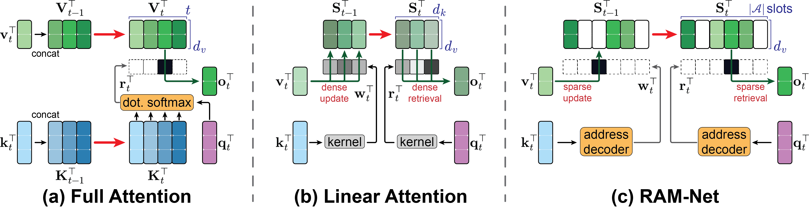
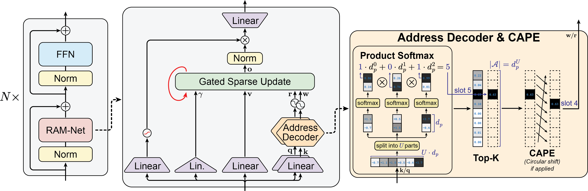
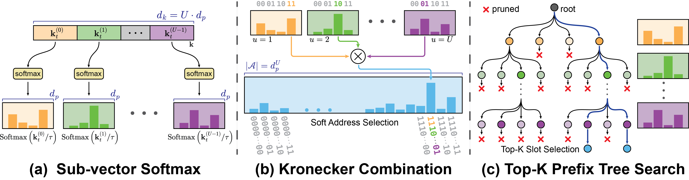

<div align="center">


**Linear-Time Sequence Modeling with Sparsely Addressable State**

Kaicheng Xiao<sup>†</sup>, Haotian Li<sup>†</sup>, Liran Dong, Guoliang Xing<br>
The Chinese University of Hong Kong

[](https://arxiv.org/abs/2602.11958)
[](https://muoncat.github.io/ramnet_web/)
[](https://huggingface.co/kaichengx/RAM-Net-Models/tree/main)
[](packages/ramnet/README.md)
[](packages/ramnet-ops/README.md)
[](LICENSE)

</div>

## Overview

Full attention stores every past token in a KV cache, which grows with sequence length.
In contrast, linear attention keeps a fixed-size state, superposing information from all tokens in one shared matrix that is accessed in full at every step.
As a result, unrelated tokens interfere with each other, and enlarging the state to hold more information raises the per-step cost proportionally.

To address these issues, **RAM-Net (Random Access Memory Network)** keeps a fixed-size state but divides it into many independent *slots*.
Each step accesses these slots through **sparse addressing**: the key of the current token selects only `K` slots to write its value into, and the query selects `K` slots to read from.
All other slots stay unchanged.

<p align="center">
  
  <br>
  <em><b>(a)</b> Full attention caches all keys and values and reads them through a softmax over every cached key; the cache grows with sequence length.
  <b>(b)</b> Linear attention compresses history into one fixed shared state and reads it through dense aggregation, causing interference between tokens.
  <b>(c)</b> RAM-Net keeps a fixed array of slots. An address decoder maps each key and query to sparse write and read addresses, so only the selected slots are updated or read.</em>
</p>

Because each step accesses only a few slots, RAM-Net has two properties:

- **Confined interference.** Tokens written to different slots are stored separately, so interference arises only in the slots they share.
- **Decoupled state size.** Each step accesses `K` slots regardless of how many slots exist, so the state can grow without increasing the per-step cost.

## Architecture

<p align="center">
  
  <br>
  <em><b>Left:</b> a RAM-Net block. <b>Middle:</b> the RAM-Net layer. <b>Right:</b> the Address Decoder and CAPE, illustrated with <code>K</code> = 1 and 8 slots, where CAPE shifts the selected slot 5 to slot 4.</em>
</p>

Each RAM-Net block applies a RAM-Net layer followed by a feed-forward network, both with pre-normalization and a residual connection.

For every head, the RAM-Net layer projects each token into a key $\mathbf{k}_t$, a query $\mathbf{q}_t$, a value $\mathbf{v}_t$, and a forgetting modulator $\gamma_t$, and then processes them in three stages:

1. **Address Decoder.** It maps $\mathbf{k}_t$ and $\mathbf{q}_t$ to a sparse write weight vector $\mathbf{w}_t$ and a sparse read weight vector $\mathbf{r}_t$ over the slots.
   Product Softmax assigns a probability to every slot, and Top-K keeps only the `K` largest.
2. **Cyclic Address Positional Embedding (CAPE).** It shifts the selected slot indices in $\mathbf{w}_t$ and $\mathbf{r}_t$ by the token position $t$, so whether a read overlaps with an earlier write depends on their relative distance.
   RAM-Net applies CAPE to some heads and leaves the others to address by content alone.
3. **Gated Sparse Update (GSU).** It writes $\mathbf{v}_t$ into the slots selected by $\mathbf{w}_t$.
   Each selected slot moves its content toward $\mathbf{v}_t$.
   A larger $\gamma_t$ overwrites more of the old content, and a smaller one preserves more of it.
   Unselected slots stay unchanged.

Finally, the layer reads $\mathbf{o}_t$ as the sum of the selected slots weighted by $\mathbf{r}_t$, and passes it through head-wise RMSNorm, a sigmoid output gate, and an output projection.

See the [paper](https://arxiv.org/abs/2602.11958) for the update equations and the [project page](https://muoncat.github.io/ramnet_web/) for interactive visualizations of addressing and slot updates.

### Product Softmax and sparse addressing

<p align="center">
  
  <br>
  <em><b>(a)</b> The key or query is split into $U$ sub-vectors, and each passes through its own softmax to give one digit distribution.
  <b>(b)</b> The product of the digit distributions gives a probability for every slot.
  <b>(c)</b> A Top-K tree search keeps the <code>K</code> most probable partial addresses at each level and returns the exact Top-K slots without computing the full distribution.</em>
</p>

A straightforward Address Decoder would project the key to one score per slot and then apply a softmax over all slots.
However, this design has two drawbacks as the number of slots grows.
First, its parameters and computation grow linearly with the slot count.
Second, it becomes hard to train, since after Top-K selection only `K` slots receive a learning signal at each step.

Product Softmax solves both problems by giving every slot a multi-digit address.
Specifically, the address **order** $U$ is the number of digits, and the **radix** $d_p$ is the number of possible values per digit, so each head has $d_p^U$ slots.
To decode an address, the key is split into $U$ sub-vectors of length $d_p$, and a softmax over each sub-vector gives a distribution over the values of one digit.
The probability of a slot is then the product of the probabilities of its digits.
The query is decoded in the same way.
As a result, the number of slots grows exponentially with $U$, while the key dimension grows only linearly; for example, $U = 5$ and $d_p = 4$ address 1,024 slots with a 20-dimensional key.
Moreover, since each digit is shared by many slots, the learning signal from a selected slot also reaches every slot that shares its digits.

RAM-Net finds the most probable slots through Top-K prefix decoding.
At each digit, it extends only the retained address prefixes with the $d_p$ possible next values, then keeps up to `K` highest-probability prefixes for the next step.
After $U$ steps, this yields the exact Top-K slot addresses without fully expanding the address space or materializing all $d_p^U$ probabilities.

## Packages

| Package                                     | Import       | Description                                                           |
|---------------------------------------------|--------------|-----------------------------------------------------------------------|
| [ramnet-ops](packages/ramnet-ops/README.md) | `ramnet_ops` | RAM-Net operator with CUDA kernels, autograd, and a PyTorch reference |
| [ramnet](packages/ramnet/README.md)         | `ramnet`     | RAM-Net attention layers and Hugging Face compatible language models  |

```text
.
|-- packages/
|   |-- ramnet-ops/    # Operator package
|   `-- ramnet/        # Attention layers and language models
|-- tests/            # Tests (run with python -m tests)
`-- examples/         # Standalone operator and Hugging Face model examples
```

## Installation

Requires:

```text
Python >= 3.10

ramnet-ops
|-- torch >= 2.5
|-- einops
`-- numpy

ramnet
|-- ramnet-ops
|-- transformers >= 4.57.3
`-- flash-linear-attention >= 0.3.2
```

### 1. Install dependencies

If PyTorch is not already installed, we **recommend PyTorch ≥ 2.10 with CUDA 13.0 (`cu130`)** for the default ops wheels below.
See the [official installation guide](https://pytorch.org/get-started/locally/) for installation commands.
Then install the remaining dependencies from TestPyPI / PyPI:

```bash
python -m pip install einops numpy "transformers>=4.57.3" "flash-linear-attention>=0.3.2"
```

For operator-only use, `einops` and `numpy` are sufficient after PyTorch.

### 2. Install ramnet-ops

The default `ramnet-ops` wheels use both **Python and PyTorch stable ABIs** and target **CUDA 13.0 (`cu130`)**.
If your environment meets **all** of the following requirements, install directly from pip; no local compiler or CUDA Toolkit is needed:

- **Python:** CPython ≥ 3.10.
- **PyTorch:** ≥ 2.10 with CUDA 13.0.
- **GPU:** SM 8.9, 9.0, 10.0, or 12.0.
- **Platform:** Windows x64 or Linux x86_64 with glibc ≥ 2.35.

```bash
python -m pip install -i https://test.pypi.org/simple/ ramnet-ops
```

If your environment **does not meet all of the requirements above**, see [Other Torch/CUDA builds (GitHub Releases)](packages/ramnet-ops/README.md#other-torchcuda-builds-github-releases) for alternative builds and their supported configurations.

For source builds, see the [ramnet-ops installation guide](packages/ramnet-ops/README.md#from-source).

### 3. Install ramnet

Install the attention layers and Hugging Face models:

```bash
python -m pip install -i https://test.pypi.org/simple/ ramnet
```

See the [ramnet README](packages/ramnet/README.md#installation) for source installation and usage examples.

## Quick start

The table maps paper notation to parameters and the operator example below.

| Paper quantity / symbol | Model parameter |     axis     |
|:-----------------------:|:---------------:|:------------:|
|    Address order $U$    |  `addr_order`   |     `U`      |
|   Address radix $d_p$   |  `addr_radix`   |     `P`      |
|  Value dimension $d_v$  |   `value_chs`   |     `C`      |
| Slots per head $d_p^U$  |                 | `A = P ** U` |
|   Selected slots $K$    |  `addr_top_k`   |   `top_k`    |

### Models (`ramnet`)

`ramnet` provides the Hugging Face model interface, including Auto classes, language-modeling loss, and cached generation with `generate`.
This example uses a small model with random weights:

```python
import torch
from transformers import AutoModelForCausalLM
from ramnet import RAMNetConfig

config = RAMNetConfig(
    hidden_size=128, num_attention_heads=4, num_hidden_layers=2,
    addr_order=3, addr_radix=4,
    embed_num=2, addr_top_k=8,
    output_norm=True,
    hidden_act="SwiGLU",
    vocab_size=1024, pad_token_id=0,
    dtype="float32",
)
model = AutoModelForCausalLM.from_config(config).cuda()
input_ids = torch.randint(3, config.vocab_size, (2, 32), device="cuda")
attention_mask = torch.ones_like(input_ids)

model.train()
output = model(
    input_ids=input_ids, attention_mask=attention_mask,
    labels=input_ids, use_cache=False,
)
output.loss.backward()
print(output.logits.shape)  # (2, 32, 1024)

model.eval()
with torch.inference_mode():
    tokens = model.generate(
        input_ids=input_ids, attention_mask=attention_mask,
        max_new_tokens=8, do_sample=False, use_cache=True,
    )
print(tokens.shape)
```

Run [model_smoke.py](examples/model_smoke.py) with `python examples/model_smoke.py`.
See the [model README](packages/ramnet/README.md) for configuration, state handling, and checkpoint saving.

### Operators (`ramnet-ops`)

`ramnet-ops` provides the attention computation core: sparse address decoding, memory updates, readout, and autograd.
This example computes attention outputs and the updated slot/mass state, then backpropagates through both:

```python
import torch
from ramnet_ops import random_access_memory_attention

device = "cuda"  # Set to "cpu" for the PyTorch reference.
backend = "cuda" if device == "cuda" else "torch"
torch.manual_seed(0)

B, T, H, U, P, C = 2, 32, 4, 3, 4, 32
w_addr = torch.randn(B, T, H, U, P, device=device, requires_grad=True)
r_addr = torch.randn(B, T, H, U, P, device=device, requires_grad=True)
values = torch.randn(B, T, H, C, device=device, requires_grad=True)
gamma = torch.randn(B, T, H, device=device, requires_grad=True)

y, (slot, mass) = random_access_memory_attention(
    w_addr, r_addr, values, gamma,
    embed_num=2, top_k=8,
    impl_backend=backend,
)
loss = y.square().mean() + slot.square().mean() + mass.square().mean()
loss.backward()
print(y.shape)  # (B, T, H, C)
print(slot.shape)  # (B, H, P ** U, C)
print(mass.shape)  # (B, H, P ** U)
```

Run [ops_smoke.py](examples/ops_smoke.py) with `python examples/ops_smoke.py --device cuda`, or use `--device cpu` for the PyTorch reference.
See the [operator README](packages/ramnet-ops/README.md) for state handling, masks, and backend options.
This example demonstrates the API; it is not an experiment configuration.

### Pretrained 1.3B model

This example downloads the [1.3B Top-8 checkpoint](https://huggingface.co/kaichengx/RAM-Net-Models/tree/main/RAMNet-1.3B-100B-Top8) and its tokenizer through Hugging Face, then generates text using BF16 on CUDA.
The first run downloads the files; subsequent runs reuse the local Hugging Face cache.

```python
import torch
from transformers import AutoModelForCausalLM, AutoTokenizer

import ramnet  # Register RAM-Net with the Hugging Face Auto classes.

repo_id = "kaichengx/RAM-Net-Models"
subfolder = "RAMNet-1.3B-100B-Top8"
tokenizer = AutoTokenizer.from_pretrained(repo_id, subfolder=subfolder)
model = AutoModelForCausalLM.from_pretrained(
    repo_id, subfolder=subfolder, dtype=torch.bfloat16,
).cuda().eval()
inputs = tokenizer("The future of artificial intelligence is", return_tensors="pt").to("cuda")

with torch.inference_mode():
    tokens = model.generate(
        **inputs,
        max_new_tokens=64, do_sample=False, use_cache=True,
        pad_token_id=tokenizer.pad_token_id,
    )
print(tokenizer.decode(tokens[0], skip_special_tokens=True))
```

Run [model_generate.py](examples/model_generate.py) with `python examples/model_generate.py`.

## Results

Zero-shot results from [the paper, Tables 1–3](https://arxiv.org/html/2602.11958v2#S5).
All models are trained on FineWeb-Edu with a 4K context, using 10B tokens at 340M scale and 100B tokens at 1.3B scale.
Per-task results are available in the paper and on the [project page](https://muoncat.github.io/ramnet_web/#results).

| Model          | WikiText ppl ↓ | Reasoning avg ↑ | S-NIAH avg ↑ | Real-world recall avg ↑ | Active state ↓ |
|----------------|---------------:|----------------:|-------------:|------------------------:|---------------:|
| ***340M***     |                |                 |              |                         |                |
| Transformer++  |          26.81 |            49.4 |         48.6 |                **35.1** |         100.7M |
| Gated DeltaNet |          26.85 |            50.1 |         51.3 |                    26.1 |           8.5M |
| Mamba2         |          26.23 |            50.6 |         35.0 |                    26.9 |          12.9M |
| GLA            |          30.03 |            49.2 |         13.3 |                    19.4 |           3.1M |
| GSA            |          29.17 |            50.0 |         21.4 |                    18.0 |           3.1M |
| RAM-Net Top-8  |          26.89 |            50.3 |         64.7 |                    23.2 |       **0.4M** |
| RAM-Net Top-16 |          26.23 |            50.5 |         65.1 |                    27.9 |           0.8M |
| RAM-Net Top-32 |      **25.87** |        **50.9** |     **72.9** |                    32.0 |           1.6M |
| ***1.3B***     |                |                 |              |                         |                |
| Transformer++  |          17.08 |            56.0 |         56.4 |                **49.8** |         201.3M |
| Gated DeltaNet |          17.09 |            56.4 |         61.0 |                    39.5 |          17.0M |
| Mamba2         |          15.96 |        **57.8** |         62.4 |                    37.5 |          26.0M |
| RAM-Net Top-8  |          16.49 |            57.4 |         65.0 |                    40.6 |       **0.8M** |
| RAM-Net Top-16 |      **15.90** |        **57.8** |     **70.1** |                    39.0 |           1.6M |

- **Reasoning avg** is the average over the ten tasks from MMLU to WinoGrande in Table 1.
- **S-NIAH avg** covers three needle-in-a-haystack tasks at context lengths from 1K to 16K, up to four times the training length.
- **Real-world recall avg** is the average over the six recall-intensive tasks in Table 3.
- **Active state** is the number of state elements accessed per step, which equals the total state size for non-RAM-Net models.
  RAM-Net's total state is 26.2M elements at 340M and 52.4M at 1.3B, and Transformer++ is measured at 2K tokens.

RAM-Net achieves the highest S-NIAH average and the lowest perplexity at both scales, while accessing at least 5× less state per step than Gated DeltaNet and 8× less than Mamba2.
Moreover, increasing `K` consistently improves perplexity and retrieval, at the cost of more state access per step.
In decoding throughput, RAM-Net with `K` = 8 matches GLA and exceeds Mamba2 and Gated DeltaNet (Figure 5 of the paper).

## Development

See the [test guide](tests/README.md) for local tests and the release guides for [ramnet](packages/ramnet/RELEASING.md) and [ramnet-ops](packages/ramnet-ops/RELEASING.md) for independent builds and publishing.

## Citation

```bibtex
@article{xiao2026ram,
  title={RAM-Net: Linear-Time Sequence Modeling with Sparsely Addressable State},
  author={Xiao, Kaicheng and Li, Haotian and Dong, Liran and Xing, Guoliang},
  journal={arXiv preprint arXiv:2602.11958},
  year={2026}
}
```

MIT License. See [LICENSE](LICENSE).
