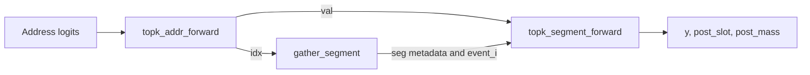

# CUDA implementation notes

This document describes the current CUDA implementation and the contracts between its internal operators. For the public API and installation, see [README](README.md).

## Layouts and notation

The public API in [ram_attn.py](src/ramnet_ops/ram_attn.py) moves the time axis and flattens broadcast batch dimensions before calling the CUDA backend. The layouts below are the internal layouts, not necessarily the caller's layouts.

`B` is the flattened batch size, `H` the head count, `U` the address order, `P` the radix, `A = P ** U` the slots per head, and `C` the value width. `Kw` and `Kr` are the write and read Top-K counts; `K = Kw + Kr`. In the parallel path, `T` below includes any padding applied by the wrapper.

| Tensor | Shape | Meaning / dtype |
| --- | --- | --- |
| `w_addr`, `r_addr` | `(B, H, U, P, T)` | Factorized address logits; FP16, BF16, or FP32 |
| `x`, `gamma` | `(B, H, T, C)`, `(B, H, T)` | Write values and forgetting modulators; same dtype as the logits |
| `slot`, `mass` | `(B, H, A, C)`, `(B, H, A)` | Recurrent state; FP32 |
| `position_ids` | `(B, T)` | CAPE positions; int32 |
| `addr_idx`, `addr_val` | `(B, H, K, T)` | Selected addresses and **signed** weights; int32 and FP32 |
| `seg_idx`, `seg_off`, `seg_len` | `(S,)` | Segment identities, offsets, and lengths; int32 |
| `event_i`, `event_v` | `(N,)` | Original event IDs and their signed weights in grouped order; int32 and FP32 |

The single-address decoder returns `(B, H, top_k, T)` instead of concatenated write/read outputs. The autoregressive path removes the singleton time axis from its inputs.

## Execution paths

[_cuda_ram_attn](src/ramnet_ops/impl/cuda_impl.py) selects one of two paths:

- **Autoregressive:** when `T == 1` and no input requires gradients, `topk_autoregressive_` decodes addresses, applies writes, and then reads the updated state in one fused kernel. It does not construct event or segment arrays.
- **Parallel:** all other cases, including single-token calls that require gradients, use the following stages.

  1. **Decode addresses into events** (`topk_addr_forward`). Each selected address produces an event: one read or write on one slot.
  2. **Group events into segments** (`gather_segment`). A segment contains the events targeting the same slot, in time order.
  3. **Process each segment sequentially** (`topk_segment_forward`). Different segments run in parallel. Each segment updates its own slot and contributes read results to `y`; the final slot and mass states are also returned.



## Address indices and CAPE

`top_k_re_norm=False` retains the selected probabilities from the product of per-digit softmax distributions. `True` renormalizes over the selected addresses. The implementation computes this in log space; the renormalized path can use sums of raw logits because the omitted per-digit normalization constants cancel.

`encode_batch_idx` controls the integer stored in `idx`:

| Setting | Stored index | Range |
| --- | --- | --- |
| `True` (Python/forward-schema default) | `(b * H + h) * A + a_idx` | `[0, B * H * A)` |
| `False` | `h * A + a_idx` | `[0, H * A)` |

Both modes retain the `(B, H, top_k, T)` tensor shape and the head offset. The flag changes only index encoding, not selected weights or CAPE.

`gather_segment` groups events by `idx`, which must encode `(b, h, a)` to keep slots from different batches distinct (`encode_batch_idx=True`). Within each slot, `val > 0` marks **writes**, `val < 0` marks **reads**, and `val == 0` marks **no-ops**.

## Segment processing

An event is described by its batch `b`, head `h`, slot `a_idx`, read/write kind, time `t`, and Top-K selection `k`. These are stored in three fields:

| Field | Information |
| --- | --- |
| `addr_idx` | The unique slot `(b * H + h) * A + a_idx`. Batch and head are included because each `(b, h)` owns a separate set of slots. |
| `addr_val` | The event weight and kind: positive for writes, negative for reads, zero for no-ops. Its magnitude is the weight used by the operation. |
| `event_id` | The original `(b, h, t, k)` coordinates, encoded as one integer. |

Although the address tensors use `(B, H, K, T)`, event IDs flatten **`(B, H, T, K)`**, with `k` fastest:

```text
event_id = ((b * H + h) * T + t) * K + k
```

`k < Kw` is a write selection; `k >= Kw` is read selection `k - Kw`. The sign of `addr_val` must agree with this ordering.

`gather_segment` stably sorts events by `addr_idx`. Events with the same unique slot form one segment, preserving time order and placing writes before reads at the same timestep. The segment kernel assigns one warp to each segment and processes its events in that order: writes update slot/mass, and reads contribute to the token output without changing the state.

After grouping, `event_i` stores the original event IDs and `event_v` stores their signed weights in the same order. For segment `s`, `seg_idx[s]` identifies its unique slot, while `seg_off[s]` and `seg_len[s]` locate its events in these arrays. The allocated capacities are `S = B * H * A` segments and `N = B * H * T * K` events; empty segments and masked events are skipped.

## Backward by state reconstruction

[`topk_segment_backward`](csrc/ram_attn_segment_parallel.cu) reconstructs earlier states while propagating gradients. It makes two passes over each segment:

1. **Scan forward again** from the initial state. For each write, save `delta = x - slot_before` and the previous mass. The actual slot increment is `gain * delta`. Save read masses as needed for mass-aware readout.
2. **Scan backward** from the final state. Recompute each write's gain from its weight, `gamma`, and saved mass, then recover the previous slot by subtracting the increment. Propagate gradients through each write; reads add output-gradient contributions without changing the slot.

```text
Forward write:  slot_after  = slot_before + gain * delta
Reverse scan:   slot_before = slot_after  - gain * delta
```

This produces gradients for event weights, `x`, `gamma`, and the initial slot/mass state. `topk_addr_backward` then propagates the weight gradients to address logits.

## Padding

The parallel address decoder requires `T` to be a multiple of **32**. The wrapper pads to the next multiple with `-inf` logits, producing zero-weight events, and trims the output back to the original length. Event IDs use the padded `T`. The fused autoregressive path handles `T == 1` directly without padding.

## Operator summary

These operators are registered under `torch.ops.ramnet_ops` in [ram_attn_bind.cpp](csrc/ram_attn_bind.cpp).

| Operator | Purpose |
| --- | --- |
| `topk_addr_single_forward` | Decode one address tensor into Top-K indices and weights, with an optional negative sign. |
| `topk_addr_single_backward` | Propagate signed-weight gradients to the single address tensor's logits. |
| `topk_addr_forward` | Decode write/read addresses together; return indices and signed weights. |
| `topk_addr_backward` | Propagate gradients of positive write/read weights to their respective logits. |
| `topk_segment_forward` | Process segments; return read output, final state, and grouped event weights saved for backward. |
| `topk_segment_backward` | Replay and reconstruct state; compute gradients for event weights, values, gamma, and initial state. |
| `topk_segment_forward_` | Process segments and return read output, updating the supplied state in place. |
| `topk_autoregressive_` | Fuse address decoding, writes, and reads for one token, updating the supplied state in place. |

The two operators ending in `_` are used without autograd.
